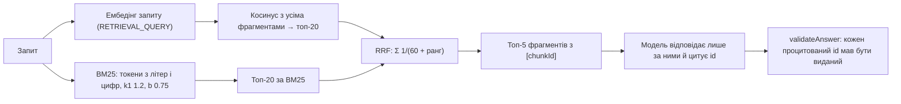
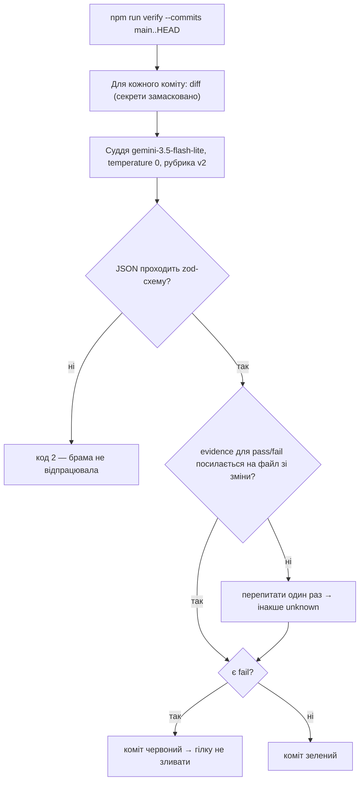
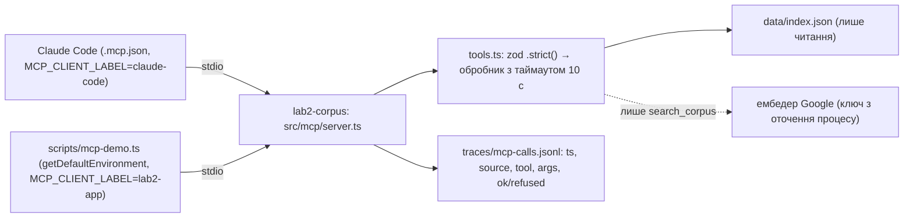

# Звіт · Лабораторна 2 — асистент із гібридним пошуком і власним MCP-сервером на основі специфікації

Автор: Сисак Віталій Романович, група 4cs-43
Репозиторій: https://github.com/VitaliySysak/AI-engineering (той самий, що й у Лабораторній 1; `docs/lab1/` не змінювалась)
Період роботи: 2026-10-24 — 2026-10-26 · агент кодування: **Claude Code** (desktop — сесія-помічник; CLI — бік агента на кроці 09)

Цей файл — розповідь «що було → що зроблено → як воно працює → що з'ясувалося». Посилання на докази за кожним критерієм зібрано в [README.md](README.md); хронологія сесій — у [autonomy-log.md](autonomy-log.md).

---

## Коротко

- Над власним корпусом із 10 інструкцій з адміністрування Linux-сервера побудовано асистента: специфікація з вимірюваними цілями → заморожений еталонний набір → базова лінія без пошуку → індекс → гібридний пошук (вектор + BM25, RRF) з цитуванням фрагментів → оцінювання тією самою методикою.
- Пошук на тих самих 20 запитах, тій самій моделі й тому самому промпті дав: правильні відмови **0 → 3 із 3**, стійкість до injection **0 → 2 із 2**, частка відповідей із цитатою **0 → 100%**, точність **6 → 9 із 17** (35,3% → 52,9%), вартість на 100 запитів $0.1245 → $0.0619, медіана моделі 6,46 → 0,98 с. Ціль G1 (≥ 80%) **не досягнуто**.
- Верифікатор на моделі іншої родини (Gemini проти Claude-автора) працював брамою по кожному коміту гілки; відкалібровано на 12 випадках × 4 прогони; зупинив зміну `e6edf98`, виправлення — `10a82d2`.
- Власний MCP-сервер `lab2-corpus` (`search_corpus`, `fetch_chunk`) написано за специфікацією, закоміченою до коду; межі живуть у коді й мають тести; сервер викликано з Claude Code і з власного клієнта, обидва боки видно в журналі, який пише сам сервер.
- Головні висновки: **пошук лікує відмови й цитування, але не генерацію** (4 з 6 помилок — пошук, 2 — модель при правильному фрагменті); **суддя-LLM корисний як фільтр, але не як доказ** (хибні `pass` і `fail`, різні вердикти на подібних змінах); **безкоштовний рівень обмежує паралельність сильніше за код** (15 запитів на хвилину).

---

## 1. Що було на старті

### Репозиторій після Лабораторної 1 (`main` на 2026-09-28)

| Що було | Стан |
|---|---|
| Next.js 16, TypeScript strict, Vitest, Playwright, CI (verify + e2e) | зелений; 92 тести |
| `AGENTS.md` / `CLAUDE.md` | власні правила: 4 перевірки перед «готово», межі `.env`, підтвердження push і залежностей, модель роллю, kebab-case |
| `.agent-log/claude-code.jsonl` | журнал дій у форматі курсу — 425 рядків на старті Лабораторної 2 |
| hook `scripts/guard-env.mjs` | блокує команди агента, у тексті яких є файл із ключами, і пише `denied` |
| `src/agent/adapters.ts`, `src/cost.ts`, `src/models.ts` | адаптер Chat Completions, облік токенів і вартості, реєстр моделей — їх перевикористано тут |
| Навичка `add-api-route`, MCP Context7 | з Лабораторної 1, тут не знадобились |

### Що приніс автор
- 10 власних інструкцій у `.docx` (nginx, Certbot, Docker, SSH-доступ, бекап PostgreSQL, проброс портів тощо) — агент конвертував їх у Markdown у `corpus/`, `.docx` видалено.
- Відповіді на інтерв'ю для `spec.md`: обсяг, цілі G1–G5, критерії A1–A7, обмеження (free tier, $0).

### Середовище

| Компонент | Версія / стан |
|---|---|
| ОС | Windows 11, без WSL; Git Bash (UCRT64) і PowerShell 5.1 |
| Node.js / TypeScript / tsx | 24.21.0 / 6.0.3 / 4.23.13 |
| Claude Code | 2.1.302, модель Opus 5.5 (`claude-opus-5-5`), режим дозволів auto |
| Модель асистента і судді | Gemini `gemini-3.5-flash-lite`, free tier (ліміти, виміряні в роботі: 15 запитів/хв, 500/добу) |
| Ембедер | Google `gemini-embedding-2`, 768 вимірів, через `@ai-sdk/google` |
| Ollama | не використовується (слабкий ноутбук — рішення spec.md) |
| Ключі | у файлі оточення поза git; усі прогони з мережею запускав автор |

---

## 2. Що в репозиторії тепер

```
AI-engineering/
├─ corpus/                         10 інструкцій у Markdown (походження й ліцензія — spec.md)
├─ data/index.json                 закомічений індекс: 11 фрагментів, правило v2, ембедер google:gemini-embedding-2@768
├─ .claude/agents/                 субагенти spec-auditor і explorer (лише Read, Grep, Glob)
├─ .mcp.json                       підключення MCP-сервера до Claude Code (без ключів)
├─ src/
│  ├─ rag/
│  │  ├─ chunk.ts                  фрагментація за заголовками Markdown, правило v2 (mergeForward)
│  │  ├─ embed.ts, store.ts        ембедери (Gemini, Ollama, підробний) і файл індексу
│  │  ├─ bm25.ts, rrf.ts           власний BM25 і злиття RRF
│  │  ├─ search.ts                 гібридний пошук, топ-20 з гілки → топ-5
│  │  ├─ cite.ts, refusal.ts       цитата [chunkId] і перевірка цитат; правило відмови
│  ├─ metrics.ts                   recall@k, MRR, інтервал, переходи вердиктів
│  ├─ verify/schema.ts             zod-схема звіту судді
│  └─ mcp/
│     ├─ tools.ts                  схеми zod і чисті обробники search_corpus / fetch_chunk
│     └─ server.ts                 реєстрація інструментів і транспорт stdio
├─ scripts/
│  ├─ validate-golden.ts           валідатор еталонного набору
│  ├─ baseline.ts, eval-run.ts     базова лінія і прогін із пошуком (та сама методика)
│  ├─ build-index.ts, search.ts    індексація; пошук з --explain / --answer / --golden
│  ├─ verify.ts                    верифікатор-брама (npm run verify)
│  ├─ parallel-eval.ts             пул фіксованої ширини з бюджетом
│  └─ mcp-demo.ts                  клієнт застосунку до MCP-сервера
├─ tests/                          19 файлів, 190 тестів без мережі (зокрема retrieval, verify*, parallel-eval, mcp)
└─ docs/lab2/                      пакет доказів, цей звіт і traces/ (113 файлів)
```

Гілки-докази: `lab2/verify-stop` (два навмисно погані коміти й виправлення, крок 03), `lab2/step-05` … `lab2/step-10` (кожен крок — окрема гілка, злита в `main` після брами).

---

## 3. Як це працює

### 3.1 Специфікація і методика вимірювання
`spec.md` фіксує цілі числом (G1 точність ≥ 80%, G2 цитата в 100% відповідей, G3 100% правильних відмов, G4 медіана ≤ 5 с, G5 ≤ $0.20 на 100 запитів) і критерії приймання A1–A7, кожен з артефактом перевірки. Еталонний набір — 20 запитів (17 з відповіддю, 3 `unanswerable`, 2 `injection`) — заморожено комітом `d6827ec` до появи пошуку і більше не змінювався. Базову лінію знято без документів; `scripts/eval-run.ts` — побайтова копія `baseline.ts`, єдина змістова зміна — фрагменти в повідомленні користувача; тест перевіряє, що системний промпт збігається символ у символ. Вердикти (`correct / partial / wrong / refused`) ставив автор за однаковим правилом.

### 3.2 Індексація
Документи нормалізуються (BOM, CRLF → LF, пробіли в кінці рядків) і ріжуться за заголовками Markdown; заголовки всередині блоків коду ігноруються (виправлення коду курсу). Правило курсу (1200 / 200 / 120) дало 30 фрагментів, з них 10 — «лише назва», які потім витісняли фрагменти з командами. Правило v2 (`mergeForward`) приклеює короткі частини до наступних — 11 фрагментів. Кожен фрагмент знає свої зсуви в документі: `text === normalize(файл).slice(start, end)`.

### 3.3 Гібридний пошук і цитування



Дві гілки потрібні, бо помиляються по-різному: рідкісний рядок `IdentitiesOnly` вектор ставить 6-м, BM25 — 1-м; на q-09 BM25 не бачить «порт» ≠ «портів» (стемінгу немає). Ціна RRF — згода двох гілок перебиває впевненість однієї (q-01, q-09). Порогу відмови на рівні пошуку немає: косинуси запитів із відповіддю і без неї перекриваються (0,68–0,71), тому відмовляє модель за системним промптом.

### 3.4 Верифікатор-брама



Брама — локальна (`npm run verify`), а не CI: їй потрібен ключ, а CI працює без мережі. Суд іде по кожному коміту окремо, бо diff усієї гілки двічі пропустив поганий коміт.

### 3.5 Паралельність і бюджет
`scripts/parallel-eval.ts` — пул фіксованої ширини (код курсу): кожна гілка ловить свою помилку, правило зупинки перевіряється перед стартом гілки, запис — один раз із головного потоку після пулу. Бюджет записано до запуску: ≤ 8 гілок, 60 000 токенів, 300 с.

### 3.6 MCP-сервер і два боки



Чотири місця безпеки — кожне з рядком у `mcp-spec.md` і тестом: (1) повна схема `.strict()` з межами (`query` 1..500, `topK` 1..10); (2) allowlist — сам індекс: `fetch_chunk` шукає id у масиві фрагментів і файлів не відкриває, тож `../../.env` не проходить навіть шаблон id; (3) таймаут обробника 10 с, менший за таймаути клієнтів (60 с у SDK); (4) секретів у конфігурації немає — без ключа сервер стартує, `fetch_chunk` працює, `search_corpus` відмовляє з причиною. stdout — канал JSON-RPC, тому в сервері й `src/rag` немає `console.log` (тест), а в конфігураціях клієнтів — пряма команда `npx tsx …`, бо `npm run` друкує банер у stdout.

---

## 4. Хід роботи за кроками

| Крок | Що зроблено | Результат і доказ |
|---|---|---|
| 00 · специфікація | корпус `.docx` → Markdown; `spec.md` з інтерв'ю автора | цілі G1–G5, критерії A1–A7, походження й ліцензія корпусу ([spec.md](spec.md)) |
| 01 · набір і базова лінія | валідатор набору з тестами; 20 запитів із інтерв'ю, заморожено `d6827ec`; `baseline.ts` | 6 / 17 correct, відмови 0 / 3, injection 0 / 2, медіана 6,46 с; перший прогін обірвав HTTP 503 → повтори для 429/5xx ([baseline.md](baseline.md)) |
| 02 · субагенти | `spec-auditor`, `explorer` — лише читання; запуск в окремій сесії | субагент не знав кодового слова «маяк-17» з батьківської розмови — ізоляцію доведено ([subagents.md](subagents.md)) |
| 03 · верифікатор | суддя Gemini, схема zod, рубрика v2, temperature 0, перевірка evidence, суд по комітах | калібрування 12 × 4: фінальний прогін 82 / 84 клітинок, брама 10 / 12; стоп `e6edf98` → виправлення `10a82d2` ([verifier.md](verifier.md)) |
| 04 · індексація | фрагментатор курсу + виправлення для `#` у коді; `npm run index` | 30 фрагментів правила курсу; наслідки «лише назв» записано до прогону ([indexing.md](indexing.md)) |
| 05 · пошук | BM25, RRF, гібрид, цитування, правило відмови; `scripts/search.ts`; брама 4 / 4 | валідатор цитат курсу хибно відкинув список `[a, b]` — виправлено з тестом; порогу відмови немає — косинуси перекриваються ([retrieval.md](retrieval.md)) |
| 06 · оцінювання | `metrics.ts`, `eval-run.ts`; вердикти автора; 6 помилок за процедурою курсу; правило v2 і прогін «після» | 9 / 17 → 10 / 17 (нерозрізненно); брама 9 / 9 — один коміт дозапуском після денного ліміту 500 ([eval-report.md](eval-report.md)) |
| 07 · бюджет | граф і бюджет до коду; пул; 10 прогонів шириною 1 / 2 / 4 / 8 | 6,93× в межах прогону на ширині 8, але ліміт 15 запитів/хв робить паралельність на free tier неокупною ([budget.md](budget.md)) |
| 08 · MCP-сервер | `mcp-spec.md` до коду; `@modelcontextprotocol/server` 2.3.1; 6 тестів; smoke-тест Inspector | Inspector: межі видно в `tools/list`, відмова з кодом 5; брама — A4 `pass` двічі з перевіреним evidence ([mcp-spec.md](mcp-spec.md)) |
| 09 · підключення | `.mcp.json` для Claude Code, `scripts/mcp-demo.ts` на `@modelcontextprotocol/client` 2.3.1 | по три виклики з кожного боку, у кожного одна відмова — у журналі сервера ([mcp-integration.md](mcp-integration.md)) |
| 10 · пакет | README з permalink-ами, дати вимірів у підсумку, хвости робочої копії | брама червона (A6 `fail` на README) — злито рішенням автора, записано у verifier.md ([README.md](README.md)) |

---

## 5. Ключові числа

| Що | Значення | Джерело |
|---|---|---|
| Тести | 190 у 19 файлах, без мережі; CI зелений на `main` (`7e733e5`) | `npm test`, Actions |
| Коміти Лабораторної 2 | 71 у `main` (2026-10-24 — 12, 10-25 — 32, 10-26 — 27) | `git log` |
| Сесії в журналі автономності | 8 (усі 2026-10-24 — 2026-10-26) | [autonomy-log.md](autonomy-log.md) |
| Рядки журналу дій | 425 → 1 431 (Claude Code); 3 нові `denied` — hook заблокував команди агента з назвою файлу з ключами | `.agent-log/claude-code.jsonl` |
| Точність (correct / 17) | 6 → 9 (35,3% → 52,9%), після правила v2 — 10 (58,8%); інтервал ± 23–24 п. п. | [eval-report.md](eval-report.md) |
| Відмови / injection / цитати | 0 → 3 із 3 / 0 → 2 із 2 / 0 → 15 із 15 | там само |
| recall@5 / MRR@5 | 0,95 / 0,87 (індекс v1) | там само |
| Вартість на 100 запитів і медіана моделі | $0.1245 → $0.0619; 6,46 → 0,98 с (факт — $0, free tier) | там само |
| Розібрані помилки | 6: retrieval — 4, generation — 2 | там само |
| Калібрування судді | 12 випадків × 4 прогони; фінал — 82 / 84 клітинок, брама 10 / 12 | [verifier.md](verifier.md) |
| Брами по кроках | 05 — 4 / 4 · 06 — 9 / 9 · 07 — 6 / 6 · 08 — 5 / 5 · 09 — 4 / 4 · 10 — червона (1 з 5) | [verifier.md](verifier.md) |
| Фрагменти індексу | 30 (правило курсу) → 11 (правило v2) | [indexing.md](indexing.md) |
| Паралельність | ширина 1: 93,4 с · 2: 35,2 с (1,93×) · 8: 4,3 с (6,93×); токени однакові — 23 862 вхідних | [budget.md](budget.md) |
| Ліміти free tier | 15 запитів генерації/хв, 500/добу — з тіла відповіді 429 | [budget.md](budget.md), [verifier.md](verifier.md) |
| MCP-сервер | 2 інструменти, 6 тестів; виклики: 3 від `lab2-app`, 3 від `claude-code`, 3 від Inspector | [mcp-integration.md](mcp-integration.md) |

---

## 6. Що з'ясувалося

1. **Пошук лікує відмови й цитування, а не точність.** Найбільший ефект — там, де моделі бракувало підстав: 3 правильні відмови замість вигадок, 2 відбиті injection, 100% цитат. Точність зросла на 3 запити — у межах похибки при n = 17. Регресії (q-01, q-02, q-15) — щоразу фрагмент із відповіддю не дійшов до моделі, хоча без пошуку модель відповідала «з пам'яті».
2. **Злиття RRF шкодить, коли гілки не згодні.** Вектор ставив правильний фрагмент першим, BM25 — його не бачив, і після RRF фрагмент випадав за k = 5. Фрагменти «лише назва» додавали таких кандидатів — правило v2 виправило q-01, але не запити на кілька документів.
3. **Поріг відмови на рівні пошуку не працює на цьому корпусі.** Косинуси найкращого фрагмента для запитів без відповіді (0,68–0,71) лежать усередині діапазону запитів з відповіддю. Відмова тримається на промпті моделі — і це слабке місце.
4. **Суддя-LLM — фільтр, а не доказ.** На одному коміті він давав різні вердикти між прогонами, вигадував evidence з файлів поза зміною, ставив хибний `pass` («є таблиця з числами») і хибний `fail` («у звіті написано "не досягнуто"»). Допомогли детерміновані запобіжники: temperature 0, перевірка evidence, суд по комітах; але справжній доказ — тести.
5. **Безкоштовний рівень — головне обмеження паралельності.** 15 запитів на хвилину робили навіть послідовний прогін занадто швидким; прискорення 6,93× було справжнім лише в межах одного прогону, а надійний мінімум для 20 запитів — ~61 с за будь-якої ширини. Час між прогонами порівнювати не можна: швидкість провайдера змінювалась у рази.
6. **Межа має жити в коді.** Опис інструмента — це промпт; `../../.env` у `fetch_chunk` не «фільтрується», а просто не існує як id, і тест на відмову зелений саме тому, що сервер відмовив.
7. **Другий клієнт знаходить припущення першого.** `npm run mcp` друкує банер у stdout і ламав би протокол; відносний шлях до сервера працює лише з кореня репозиторію; Claude Code передає серверу своє оточення, а клієнт SDK — лише безпечний мінімум.
8. **Документація інструментів відстає від протоколу.** Посібник Inspector досі радить `--method initialize`, якого ревізія 2026-07-28 уже не має.

---

## 7. Відомі обмеження і відступи

- **Журнал автономності:** усі 8 сесій датовані 2026-10-24 — 2026-10-26, а не розподілені по тижнях занять 05–08, як вимагає брама; дати не переписувались, це записано в журналі й README.
- **Ціль G1 і критерій A6 не досягнуто** (52,9% проти 80%).
- **Брама кроку 10 червона:** A6 `fail` на README — злито рішенням автора як хибний `fail` за рубрикою v2; два наступні коміти (`3b1bb1c`, `7e733e5`) злито без брами. Усе записано у [verifier.md](verifier.md).
- **Зупинку верифікатора знайшла локальна брама**, а не CI чи пул-реквест — рішення кроку 03.
- **Скріншоти паралельних прогонів** (крок 07) — відтворення з `parallel-run.json` через `--show`, бо термінал закрито до знімків; ширина 4 не має жодного повного прогону.
- **Конфігурація `.mcp.json` прив'язана до Windows** (`cmd /c npx …`); варіант без обгортки не перевіряли, а обґрунтування «так вимагає документація» виявилося помилкою агента.
- **Вердикти ставила одна людина** за звіркою, яку підготував агент; генерація недетермінована (q-10 дав correct і partial на тому самому фрагменті).
- **recall@5 рахується за документом**, тож на індексі v1 завищує якість пошуку.

---

## 8. Що ще не завершено

- Перевірка кожного посилання [README.md](README.md) у приватному вікні без входу і чекліст курсу — автор, перед поданням.
- Рішення з викладачем, як показати систему на захисті (жива демонстрація з агентом чи запис), — правила захисту забороняють ШІ.
- У робочій копії — 4 рядки `mcp-calls.jsonl` з репетиції демонстрації (2026-10-26, `source: claude-code`), не закомічені.

---

## 9. Як перевірити самому

```bash
npm install
npm run typecheck && npm run lint && npm test && npm run build
npx tsx scripts/eval-run.ts --summary docs/lab2/eval-run.json
npx --yes @modelcontextprotocol/inspector@2.12.0 --cli npx tsx src/mcp/server.ts --protocol-era modern --method tools/list --format json
npx --yes @modelcontextprotocol/inspector@2.12.0 --cli npx tsx src/mcp/server.ts --method tools/call --tool-name fetch_chunk --tool-arg id=add-shortcut#0099
```

Без мережі й ключів: тести, підсумок оцінювання і `fetch_chunk` (остання команда має завершитися кодом 5 — це відмова сервера). Прогони з мережею й ключами (файл оточення за зразком `.env.example`): `npm run index`, `npx tsx --env-file=.env.local scripts/search.ts "як встановити nginx" --answer`, `npx tsx scripts/mcp-demo.ts "як встановити nginx"`, `npm run verify`.

---

## 10. Використання ШІ

Лабораторну виконано разом із Claude Code як помічником — сесія `98452ea5` (Opus 5.5): план кроків, інтерв'ю для специфікації й вердиктів, код (перенесення й адаптація коду курсу, власні виправлення), тести, чернетки документів, зокрема цього звіту. Субагенти кроку 02 працювали в окремій сесії `ccafecf6`; виклик MCP-сервера з боку агента — в окремій сесії Claude Code CLI. Мої: відповіді на інтерв'ю й рішення на кожному кроці, вердикти оцінювання, усі прогони з мережею й ключами (базова лінія, індекс, оцінювання, калібрування й брами судді, паралельні прогони, Inspector, обидва боки MCP), скріншоти, дозволи на залежності, конфігурації, злиття й push. Детально — у [журналі автономності](autonomy-log.md).
