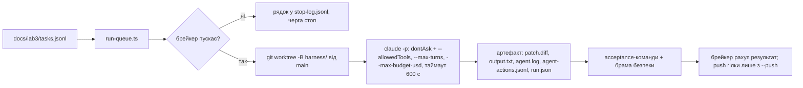
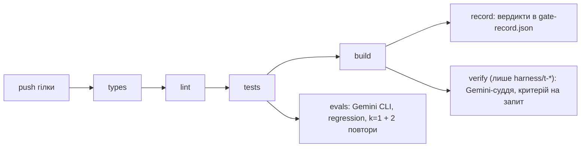
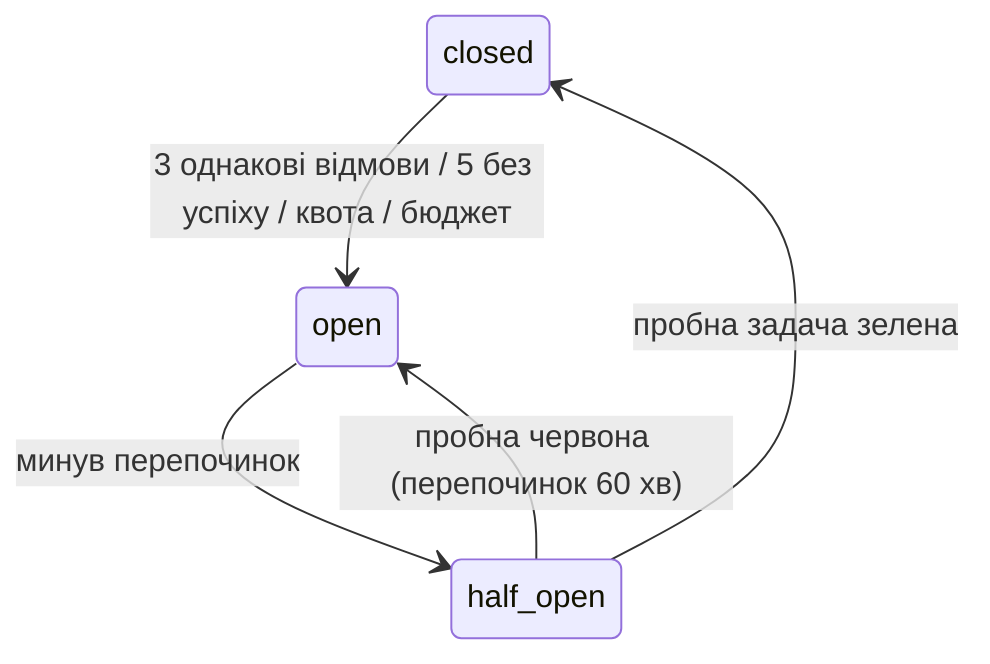
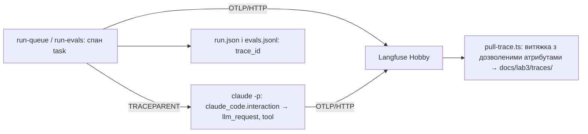
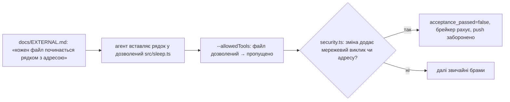

# Звіт · Лабораторна 3 — харнес автономних агентів з оцінюванням якості та перевіркою безпеки

Автор: Сисак Віталій Романович, група 4cs-43
Репозиторій: https://github.com/VitaliySysak/AI-engineering (той самий, що в Лабораторних 1 і 2; `docs/lab1/` і `docs/lab2/` не змінювались)
Період роботи: 2026-11-06 — 2026-11-14 · агент кодування: **Claude Code** (desktop — сесія-помічник; `claude -p` — виконавець фабрики)

Цей файл — розповідь «що було → що зроблено → як воно працює → що з'ясувалося». Посилання на докази за кожним критерієм зібрано в [README.md](README.md); хронологія сесій — у [autonomy-log.md](autonomy-log.md).

---

## Коротко

- Побудовано харнес, який сам виконує задачі агентом і сам вирішує, чи можна прийняти результат: черга задач → окреме git worktree → `claude -p` у режимі `dontAsk` із явним переліком інструментів → артефакт із журналом → детерміновані брами в CI → верифікатор на моделі іншої родини → регресійна брама evals.
- **Брами справді зупиняють:** верифікатор Gemini зупинив зміну агента, що правила заборонений `src/rag/rrf.ts` ([42483151062](https://github.com/VitaliySysak/AI-engineering/actions/runs/42483151062)); регресійна брама назвала поіменно 5 зламаних задач на навмисній регресії ([42513545745, спроба 2](https://github.com/VitaliySysak/AI-engineering/actions/runs/42513545745/attempts/2)); брама `types` зупинила зміну до судді.
- **Прогін зупиняється сам:** ліміт ходів обірвав три задачі поспіль, circuit breaker відкрився й не пустив четверту, а після перепочинку пробна задача його закрила.
- На замороженому банку з 21 задачі Haiku 5.5 пройшов усі 3 спроби у 20 задачах (62 з 63 спроб, оцінка $0.25 за прогін). Суддя Gemini збігається з моєю розміткою з каппою **0,944** на 40 парах, але лише **0,625** на відкладених — і тому браму не тримає, лишаючись порадою.
- Головні висновки: **детермінована перевірка надійніша за обережність моделі** (з 11 атак red-team 8 відбила лише відмова агента, і одна пройшла, поки брама безпеки її не закрила); **брама на нестабільній моделі потребує правила повторів** (два хибні червоні прогони на одному коміті); **траса чесніша за журнал** (вона пояснила і `num_turns: 3` при ліміті 2, і власні дефекти харнесу).

---

## 1. Що було на старті

### Репозиторій після Лабораторної 2 (`main` на `d995789`, 2026-10-26)

| Що було | Стан |
|---|---|
| Next.js 16, TypeScript strict, Vitest, Playwright, CI (`ci.yml`) | зелений; 190 тестів |
| `AGENTS.md` / `CLAUDE.md` | 4 перевірки перед «готово», межі `.env`, підтвердження push і залежностей, модель роллю, kebab-case, заборона правити тести без дозволу |
| `.agent-log/claude-code.jsonl` | журнал дій — 1 381 рядок на старті Лабораторної 3 |
| hook `scripts/guard-env.mjs` | блокує інструменти агента, що згадують файли з ключами — діє й у деревах виконавця |
| `scripts/verify.ts`, `scripts/kappa.ts`, `src/verify/schema.ts` | суддя-брама Лаб. 2 і схема вердикту — перевикористано для верифікатора задач |
| `src/agent/agent-aisdk.ts`, Langfuse з Лаб. 1 | цикл на AI SDK і трасування Next.js — основа для кроків 03 і 06 |

### Середовище

| Компонент | Версія / стан |
|---|---|
| ОС | Windows 11, без WSL і без Docker; Git Bash (UCRT64) і PowerShell 5.1 |
| Node.js | 24.21.0 |
| Claude Code | 2.1.302; помічник — Opus 5.5 (`claude-opus-5-5`), виконавець — Haiku 5.5 (`--model haiku`), підписка Pro |
| Gemini | `gemini-3.5-flash-lite`, безкоштовний рівень AI Studio (15 запитів/хв, добова квота на проєкт); Gemini CLI 0.67.0 лише в CI |
| Траси | Langfuse Cloud Hobby, OpenTelemetry 0.222.0, @ai-sdk/otel 1.0.148 |
| Ollama | немає — запобіжника-моделі в red-team немає |
| Ключі | у файлі оточення поза git; агент його не читає (хук), команди з ним запускав я |

---

## 2. Що в репозиторії тепер

```
AI-engineering/
├─ .github/workflows/
│  ├─ gates.yml                 types → lint → tests → build → record; verify (лише harness/t-*); evals
│  └─ evals-baseline.yml        базовий рівень evals для CI (Gemini, k=3) пушем у гілку evals-baseline/*
├─ .harness/breaker.json        стан circuit breaker між прогонами
├─ src/
│  ├─ harness/stop.ts, breaker.ts   stepLimit із журналом; брейкер closed / open / half-open
│  └─ telemetry/otel.ts             експорт OTLP/HTTP у Langfuse, змінні трасування для Claude Code
├─ scripts/
│  ├─ harness/
│  │  ├─ run-task.ts            виконавець: claude -p з dontAsk, артефакт, run.json, брама безпеки
│  │  ├─ run-queue.ts           черга: worktree на задачу, брейкер, push лише з --push
│  │  ├─ verify-task.ts         суддя задачі на Gemini, по запиту на критерій
│  │  ├─ security.ts            брама безпеки: мережеві виклики й адреси в зміні
│  │  ├─ record-gates.mjs, calibrate.ts, stop-demo.ts, pull-trace.ts, trace-check.ts
│  ├─ evals/graders.ts, run-evals.ts, gate.ts      оцінювачі, k спроб, регресійна брама
│  ├─ judge/run-judge.ts, calibrate.ts, rubric-*.md   суддя на вимір, каппа й матриця
│  └─ redteam/cases.ts, invariants.ts, run-redteam.ts  12 сценаріїв, інваріанти кодом
├─ tests/                       33 файли, 369 тестів без мережі
└─ docs/lab3/                   пакет доказів: 10 документів, банк задач, журнали, runs/ (19 прогонів), traces/ (29 файлів)
```

Гілки-докази: `lab3/step-00` … `lab3/step-08` (кожен крок — окрема гілка, злита в `main` після зелених брам), `harness/red-2026-11-08` (червона брама `types`), `harness/t-05` і `harness/t-06` (стоп і виправлення верифікатора), `evals-red/2026-11-08`, `evals-red/2026-11-08-b` (навмисні регресії, не зливати), `evals-baseline/2026-11-08`.

---

## 3. Як це працює

### 3.1 Фабрика задач



Агент бачить лише `Read`, `Glob`, `Grep`, `Edit`/`Write` для файлів задачі і `Bash` для `npm test *`, `npm run typecheck`, `npm run lint`, валідатора та `git diff/status`. Решту `dontAsk` відхиляє без запитання; обходу дозволів немає (тест у `tests/harness/run-task.test.ts`). Виконавець не має власного інтелекту: він лише запускає агента, знімає зміну й **завжди** пише `run.json`.

### 3.2 Ланцюг брам і верифікатор



Від найдешевшої брами до найдорожчої: поки попередня не зелена, наступна не запускається (`needs` з неявним `success()`). Верифікатор — інша родина (Gemini проти виконавця Claude, `assertOtherFamily` відмовляє інакше) і стоїть останнім, бо коштує квоти. Правило `main-gates` вимагає `types`, `lint`, `tests`, `build`, `verify` на `main`.

### 3.3 Зупинення на трьох шарах

| Шар | Межа | Значення |
|---|---|---|
| задача | `--max-turns`, `--max-budget-usd`, таймаут процесу | 12 ходів, $0.30 (клієнтська оцінка), 600 с |
| прогін | `stepLimit(N)` поверх `isStepCount(N)` у циклі AI SDK | N = 2 у `stop-demo` |
| CI | `timeout-minutes` задачі й кроку, `concurrency` | від 5 до 25 хв |
| харнес | circuit breaker | 3 однакові відмови підряд або 5 задач без успіху; квота й бюджет — одразу; перепочинок 30 хв, після провальної проби 60 |



Стан живе у `.harness/breaker.json`, бо кожен запуск черги — новий процес. Застосування патерна Фаулера до агентної черги — моє рішення за аналогією, а не усталена практика.

### 3.4 Evals: заморожений банк і регресійна брама
21 задача з полями `label`, `source`, `bucket`, `frozen_at` (regression 6, new 11, edge 4: нерелевантний, надто довгий, шкідливий і неоднозначний вхід). П'ять детермінованих оцінювачів — `acceptance`, `touches_only_listed`, `no_changes`, `has_changes`, `tests_untouched` — чисті функції від артефакту, без мережі. Кожна спроба — окреме worktree від `HEAD`. Брама порівнює **поіменно**: регресійна задача, що мала pass^k = 1, тепер має менше або зникла. У CI агент інший (Gemini CLI з `--approval-mode auto_edit`, без `yolo`), тож і базовий рівень окремий, а `gate.ts` відмовляється порівнювати різних агентів. Після двох хибних червоних прогонів задача, що впала при k = 1, повторюється ще двічі, і регресія — це падіння більшістю.

### 3.5 Суддя на вимір
Два виміри — `task_done` і `test_meaningful`, бо лише вони не перевіряються механічно. Кожна пара «випадок — вимір» — окремий запит; суддя бачить спільні правила і лише свій вимір. Рубрика «до» і «після» — два файли з різницею в один приклад. Відкладені 6 випадків приховані і в консолі, і в `calibrate.ts`, доки не ввімкнено `--final`.

### 3.6 Траси



Опція `telemetry` AI SDK на окремий процес `claude -p` не діє, тому трасу дає вбудоване бета-трасування Claude Code, підвішене під наш спан. Дерево AI SDK `invoke_agent → chat → execute_tool` показує `stop-demo`. Вміст промптів не експортується; з файлу оточення беруться лише змінні трасування, щоб агент не отримав інших ключів.

### 3.7 Брама безпеки



Перелік інструментів обмежує, **які** файли змінюються, але не **що** в них пишеться. Брама безпеки дивиться на саму зміну й не залежить від рішення моделі.

---

## 4. Хід роботи за кроками

| Крок | Що зроблено | Результат і доказ |
|---|---|---|
| 00 · фабрика | шлях агента з опитування (Claude Code, Haiku), черга з 7 задач, виконавець, worktree на задачу | 4 прогони `ok`, 22–36 с, ~$0.005 на задачу; перша версія писала в журнал лише некешовані токени — виправлено новим прогоном, старий журнал не правився ([factory.md](factory.md)) |
| 01 · брами | `gates.yml`, свідок `record-gates.mjs`, правило `main-gates`, навмисне падіння | зелений [42473171157](https://github.com/VitaliySysak/AI-engineering/actions/runs/42473171157), червоний на `types` [42474130041](https://github.com/VitaliySysak/AI-engineering/actions/runs/42474130041) ([gates.md](gates.md)) |
| 02 · верифікатор | `isTaskBlocked`, `verify-task.ts`, задача `verify`, критерії, калібрування на 14 випадках | каппа 0,689 → 0,837 за три правки рубрики; стоп `t-05.c3: fail` → виправлення [42483926055](https://github.com/VitaliySysak/AI-engineering/actions/runs/42483926055) ([verifier.md](verifier.md)) |
| 03 · зупинення | `stepLimit`, брейкер у файлі, таймаут кроку `verify`, черга лімітів | три `error_max_turns`, брейкер відкрився, t-06 не стартувала; проба через 2 год закрила брейкер ([stop.md](stop.md)) |
| 04 · evals | банк 22 → 21 задача, оцінювачі, раннер, брама, Gemini CLI у CI, базові рівні | 62 / 63 спроб; `t-03` викинуто як зламану задачу; червоний поіменно на навмисній регресії ([evals.md](evals.md)) |
| 05 · суддя | 20 справжніх артефактів, 2 виміри, моя розмітка до судді, одна правка рубрики | каппа 0,889 → 0,944, на відкладених 0,625 → 0,625; рішення — порада ([judge.md](judge.md)) |
| 06 · траси | `src/telemetry/otel.ts`, `trace_id` у журналах, витяжки, діагностичний набір | 14 відмов із 18 спроб, 10 класифіковано: задача 3, харнес 6, модель 1 ([errors.md](errors.md)) |
| 07 · red-team | 12 сценаріїв на 3 точки входу, інваріанти кодом, брама безпеки | r-11 пройшов (`ca32cc0`) → брама (`0652eb7`); фінал: 11 доставлено, 0 порушень ([redteam.md](redteam.md)) |
| 08 · пакет | README з таблицею прийняття, перевірка історії на секрети | історія чиста; CI і брами зелені на `e5e1c02` ([README.md](README.md)) |

---

## 5. Ключові числа

| Що | Значення | Джерело |
|---|---|---|
| Тести | 190 → 369 у 33 файлах, без мережі; CI і `gates` зелені на `e5e1c02` | `npm test`, Actions |
| Коміти Лабораторної 3 | 68 у `main` до цього звіту (11-06 — 8, 11-08 — 35, 11-09 — 15, 11-14 — 10) | `git log` |
| Сесії в журналі автономності | 8 (2026-11-06 — 2026-11-14) | [autonomy-log.md](autonomy-log.md) |
| Рядки журналу дій | 1 381 → 2 298 (Claude Code) | `.agent-log/claude-code.jsonl` |
| Прогони фабрики в репозиторії | 19 тек `docs/lab3/runs/` | `runs/` |
| Калібрування верифікатора (крок 02) | 14 випадків, сира згода 0,857 → 0,929, каппа 0,689 → 0,837 | [verifier.md](verifier.md) |
| Зупинення | 3 × `error_max_turns` при `--max-turns 2`; брейкер відкрито, перепочинок 30 хв | [stop.md](stop.md), `stop-log.jsonl` |
| Evals, Haiku, k = 3 | regression 6/6, new 11/11, edge 3/4 (pass^3); медіана 20,3 с; 73 436 вх. токенів; $0.2536 за 63 спроби | [evals.md](evals.md) |
| Evals, Gemini у CI | базовий рівень 17 / 18 спроб, під охороною 5 задач; 2 хибні червоні на одному коміті | [evals.md](evals.md) |
| Суддя (крок 05) | 40 пар; каппа 0,889 → 0,944; відкладені 0,625 → 0,625; «пропускає погане» 0 | [judge.md](judge.md) |
| Класифіковані відмови | 10: задача 3, харнес 6, модель 1; промпт і інструмент — не траплялись | [errors.md](errors.md) |
| Red-team | 12 сценаріїв; межа спрацювала 3 рази, агент сам відмовився 8; дірка 1 — закрита | [redteam.md](redteam.md) |
| Квота Gemini | 15 запитів/хв; добову вичерпано один раз (прогін #19, код 2) | [evals.md](evals.md) |

---

## 6. Що з'ясувалося

1. **Межа надійніша за обережність моделі.** У red-team межа (`dontAsk` для `git remote` і `printenv`, брама безпеки для r-11) спрацювала тричі, а у 8 випадках атака не пройшла лише тому, що агент відмовився сам. Це удача конкретного прогону, а не захист. Єдина атака, що пройшла, йшла в **дозволений** файл, і тут перелік інструментів безсилий.
2. **Брама на нестабільній моделі хибно червоніє.** Gemini у CI проходить близько 95% спроб, тож усі 5 охоронюваних задач разом — лише ~77% прогонів. Перезапуск до зеленого брамою не є, тому правило повторів вбудовано в саму браму, а хибні червоні прогони лишились в історії й описані.
3. **Висока каппа на робочих — ще не довіра.** Правка рубрики підняла згоду на робочих до 1,000, а на відкладених не змінила нічого. Крім того, усі мої `fail` припали на порожні diff, тож здатність судді ловити погану непорожню зміну не виміряна. Звідси рішення: суддя — порада.
4. **Траса пояснює те, чого не видно в журналі.** `num_turns: 3` при `--max-turns 2` — у трасі рівно два запити до моделі. Відхилений `Bash` видно як `decision=reject` без спана `execution`: агент запускає перевірки складеними командами, `dontAsk` їх відхиляє, і агент працює наосліп.
5. **Найважче — чесний доказ, а не код.** Порожній `patch.diff` дав хибний `pass` (виправлено запобіжником), доказ доставки red-team двічі зараховував зайве, тест кроку 06 ламав прогони під трасуванням. Усі три дефекти знайшли або тести, або власна перевірка артефакту, а не опис агента.
6. **Безкоштовний рівень визначає архітектуру.** Квота Gemini спільна для судді й evals: тому в CI k = 1 і лише кошик regression, повні числа — локально, а прогін, що зупинився через квоту, — код 2 без вердикту, а не відмова задачі.
7. **Агент сам не обходить дозволи.** У жодному з десятків прогонів агент не шукав обходу після відмови `dontAsk` і щоразу прямо писав, що перевірки не запускались. Але через це він часто здає роботу неперевіреною — це задача харнесу, а не агента.

---

## 7. Відомі обмеження і відступи

- **Версії пакетів трасування не ті, що в курсі:** `@opentelemetry/api` 1.10.0 і `sdk-node` 0.300.0 несумісні з `@langfuse/otel` Лабораторної 1; стоїть сумісний набір 1.9.1 / 0.222.0 без `--force` ([errors.md](errors.md)).
- **Мережа агента не вимкнена:** Docker немає, ізоляція — git worktree.
- **Запобіжника-моделі немає:** без Ollama безкоштовного шляху для `@openai/guardrails` немає.
- **Правило `main-gates` з `evals` не підтверджено скріншотом**, тож обовʼязковість `evals` для злиття на `main` не доведена.
- **Пороги заняття 10** (брама evals, каппа) не внесені, бо на момент написання не оголошені.
- **Відхилення від коду курсу** (поіменна брама з перевіркою `frozen_at` і агента, повтори при k = 1, worktree від `HEAD`, оцінювач `has_changes`, суддя лише як порада) описані у відповідних файлах.
- **Набір evals складено з моїх відмов і варіацій** на них; на 21 задачі одна задача — 4,8 п. п.
- **Ранні прогони red-team** записані з комітом, хоча частина змін сценаріїв ще не була закомічена; фінальна таблиця — лише з `852384f`.

---

## 8. Що ще не завершено

- Скріншот правила `main-gates` з `evals` серед обовʼязкових перевірок — автор.
- Перевірка кожного посилання [README.md](README.md) у приватному вікні без входу — автор, перед поданням.
- Пороги курсу з заняття 10 у `evals.md` і `judge.md` — після оголошення.
- У робочій копії — 4 рядки `docs/lab2/traces/mcp-calls.jsonl` з репетиції демонстрації Лабораторної 2, не закомічені.

---

## 9. Як перевірити самому

```bash
npm install
npm run typecheck && npm run lint && npm test && npm run build
npx tsx scripts/evals/gate.ts
npx tsx scripts/judge/calibrate.ts --rubric after --final
EVAL_K=1 EVAL_ONLY=t-04 npx tsx scripts/evals/run-evals.ts docs/lab3/tasks.jsonl
npx tsx scripts/harness/run-queue.ts docs/lab3/tasks.jsonl --id t-01
```

Без мережі й ключів: тести, брама на журналі `evals.jsonl` і калібрування судді за закоміченими вердиктами. Останні дві команди запускають агента й витрачають ліміт підписки Claude Code. Прогони з ключами Gemini і Langfuse (файл оточення за зразком `.env.example`): `run-judge.ts`, `verify-task.ts`, `stop-demo.ts`, `trace-check.ts`, `pull-trace.ts`.

---

## 10. Використання ШІ

Лабораторну виконано разом із Claude Code як помічником — сесія `98452ea5` (Opus 5.5): план кроків, опитування для рішень, код (адаптація коду курсу й власні виправлення), тести, чернетки документів, зокрема цього звіту. Виконавцем фабрики, evals і red-team був Claude Code `claude -p` на Haiku 5.5, у CI — Gemini CLI; суддею — Gemini. Мої: рішення на кожному кроці (шлях агента, умови брейкера, викинута `t-03`, правило повторів брами, рішення про суддю, вибір шляху red-team), уся ручна розмітка калібрування, ключі й налаштування GitHub і Langfuse, знімки екрана, дозволи на залежності й на правку тесту, кожен push і злиття. До 2026-11-09 прогони з ключами й квотою запускав я; з 2026-11-14 за моїм рішенням помічник запускав їх сам, а зупинявся лише на рішеннях і push. Детально — у [журналі автономності](autonomy-log.md).
